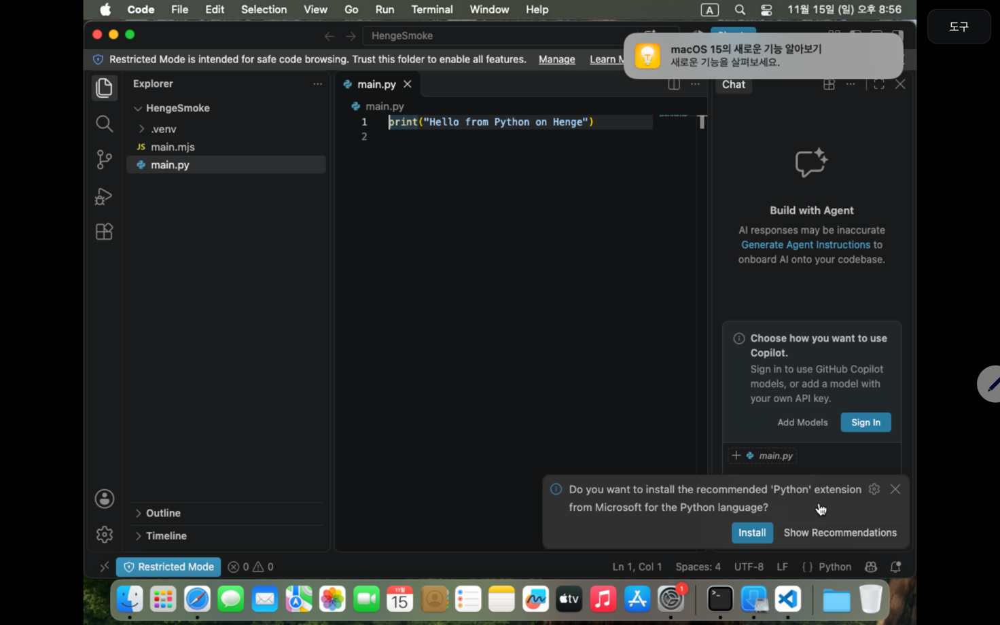
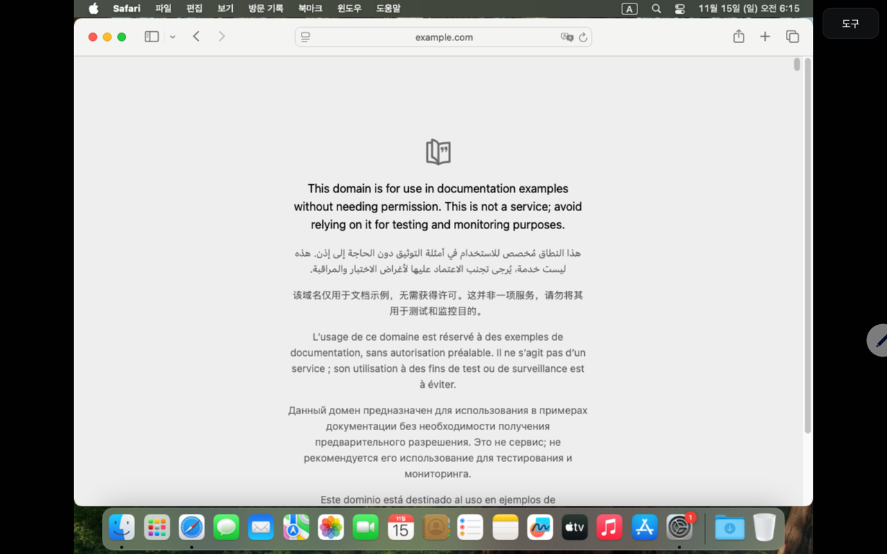
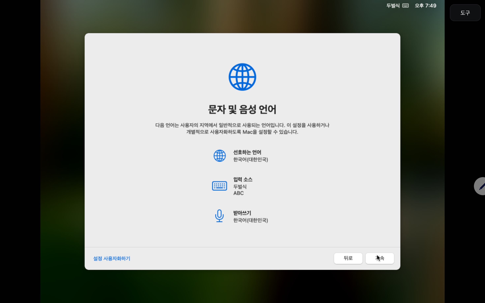

# NaruVM

[English](README.md) · [영상](#영상) · [스크린샷](#스크린샷) · [설치 안내](docs/installation.ko.md) · [호환성](#현재-상태) · [자주 묻는 질문](#자주-묻는-질문)

[](https://github.com/hericobacter-spec/NaruVM/actions/workflows/android-source.yml)

**[v0.1.3-preview APK 다운로드](https://github.com/hericobacter-spec/NaruVM/releases/tag/v0.1.3-preview)** · **[APK 설치·소스·검증](docs/apk-release.ko.md)** · [문제 해결](docs/installation.ko.md#문제-해결)

Henge의 ARM64 JIT·소프트웨어 MMU·가상 장치를 Android NDK/Bionic 앱으로 옮긴 **독립 실험 포트**입니다. 그래픽은 Reims → metal2vulkan → Vulkan 경로를 사용합니다. 원본 Henge의 공식 Android 지원 제품은 아닙니다.

**실험용 미리보기**입니다. v0.1.3-preview에는 서명한 ARM64 APK, 프로젝트·의존성 소스와 체크섬을 제공합니다. 기존 v0.1은 소스 전용으로 유지합니다. GPU 오류·태블릿 재부팅·느린 동작은 해결 완료를 주장하지 않습니다. 이번 후보는 에뮬레이터에서 확인했으며 실기기·macOS 게스트 재검증은 하지 못했습니다. Apple 이미지·게스트 디스크·계정·개인 서명키는 포함하지 않습니다.

**v0.1.2-preview 그래픽 수정:** 관찰한 에뮬레이터 셰이더 충돌을 수정하고, 기능이 부족한 시스템 Vulkan은 충돌 없이 거부하도록 바꿨습니다. 자동 검사 5회와 자체 작성 읽기 검사 150프레임을 통과했습니다(observed). 작은 캐시 비교 검사의 중앙값은 143.7ms → 70.0ms였으며 macOS 전체 속도 측정은 아닙니다. [원인·재현·한계](docs/graphics-verification.ko.md).

기존 연구 앱과 새 APK의 서명키가 다릅니다. **기존 앱을 삭제하거나 데이터를 지우지 말고 별도 기기·에뮬레이터를 사용하세요.** [APK 설치 안내](docs/apk-release.ko.md)를 먼저 확인하세요.

**v0.1.3-preview 입력·화면 개선:** 입력 대기열 제한과 작업 스레드의 프레임 준비가 서명 APK(버전 코드 4)에 포함됐습니다. 한 에뮬레이터에서 기존 공개 APK 업데이트·자체 프레임/입력·서비스 검사를 통과했습니다(observed). [검증·재현·한계](docs/response-verification.ko.md).

## 영상

**[20초 MP4 보기 / 다운로드](https://raw.githubusercontent.com/hericobacter-spec/NaruVM/main/docs/videos/historical-captures.mp4)** · [장면 설명과 제작 자료](docs/videos/README.ko.md)

[](https://raw.githubusercontent.com/hericobacter-spec/NaruVM/main/docs/videos/historical-captures.mp4)

아래 스크린샷 3장을 이어 붙인 무음 소개 영상이며 **실시간 실행 녹화가 아닙니다**.
확인한 로컬 연구 폴더에서 실행 녹화 원본을 찾지 못했습니다. 조작 속도·연속 설치·
장기 안정성을 보여 주는 자료는 아닙니다. 미리보기를 누르면 MP4가 열립니다.
브라우저가 다운로드하면 저장된 파일을 영상 플레이어로 열어 주세요.

## 스크린샷

v0.1 이전 **TB373FU 한 대의 macOS 15 연구 실행**에서 촬영한 기존 화면입니다.
현재 Android 홈이 아닌 게스트 화면이며, 개별 화면의 관측 사례입니다.
전체 자동 설치·장기 안정성·네이티브 수준 속도가 검증됐다는 뜻은 아닙니다.

| 게스트에서 연 VS Code | Safari의 example.com 페이지 |
| --- | --- |
|  |  |

<details>
<summary>초기 설정 화면과 촬영 맥락</summary>



새 Android 원샷 설치기 이전의 화면입니다. 이번 보완에서는 기존 파일을 수정 없이
복사했으며 새 게스트 실행은 하지 않았습니다. [촬영 자료와 한계](docs/images/README.md).

</details>

## 어떤 방식으로 실행하나요?

게스트는 Android 기기 안에서 실행합니다. Henge의 같은 ISA 간 ARM64 변환과
소프트웨어 MMU를 Android에 적용한 구조이며, Android 하드웨어 하이퍼바이저나
원격 Mac을 사용하는 방식이 아닙니다. 게스트 Metal 명령은 Reims·metal2vulkan을
통해 선택한 Vulkan 백엔드로 전달합니다. CPU 변환·메모리 처리·GPU 호환성이
각각 속도에 영향을 줄 수 있고, 같은 ARM64라고 네이티브 속도가 보장되지는 않습니다.

Android 포트는 한국어·영어 네이티브 화면, VM·설치 포그라운드 서비스,
터치·외부 입력, CPU/RAM/그래픽 설정, NAT 네트워크와 실험용 Apple 다운로드·복구
설치를 추가합니다. 원본·의존성의 저작권과 라이선스는 유지합니다. 앱 표시 이름은
NaruVM이며 내부 `henge` 경로와 `dev.henge.research` 패키지는 이력·호환성 때문에
남아 있습니다.

## 어디서 시작하나요?

[서명된 실험용 APK](docs/apk-release.ko.md)를 설치하거나 직접 빌드할 수 있습니다. **Android 앱 설치와 앱 안의 macOS 설치는
별도 단계**입니다.

| 목적 | 안내 |
| --- | --- |
| 준비물부터 설치·첫 실행까지 따라가기 | [한국어 설치 안내](docs/installation.ko.md) |
| Android 기기 없이 소스 검사 | [처음 확인하기](#처음-확인하기) |
| CPU·호스트 진단용 앱 빌드 | [기본 진단 A](docs/installation.ko.md#a-기본-진단-앱) |
| CPU 렌더링으로 그래픽 게스트 시험 | [그래픽 구성 B](docs/installation.ko.md#b-그래픽--cpu-렌더링) |
| TB373FU에서 관측된 드라이버 경로 재현 | [PanVK 구성 C](docs/installation.ko.md#c-tb373fu-panvk-연구-구성) |
| 빌드·설치·부팅 오류 기록 | [문제 해결과 기록](docs/installation.ko.md#문제-해결) |

설치 안내에 소스 복제·고정 도구 준비·정확한 빌드 명령·USB 디버깅·서명 업데이트·
호환성 검사·저장 공간·계정 설정·입력·네트워크 순서를 담았습니다.
[개발자 빌드 참고](docs/building.md)는 드라이버·소스 재현과 검사 세부 사항을 다룹니다.

처음 시험하는 순서는 **APK 다운로드·서명 확인 → APK 설치 → CPU·RAM·그래픽 선택과
호환성 검사 → 새 게스트 다운로드·설치 시작 → macOS 초기 설정**입니다.
2코어 / RAM 2048 MiB부터 시작하세요. TB373FU의 자동/PanVK는 빌드 C를 사용하고,
빌드 B라면 CPU 렌더링을 직접 선택해야 합니다. 각 단계의 준비물과 명령은
[전체 설치 안내](docs/installation.ko.md)에 있습니다. 공개 APK의 구성·검증·한계는
[APK 배포 안내](docs/apk-release.ko.md)를 확인하세요.

## 현재 상태

2026-11-16에 관측한 실기기는 Lenovo TB373FU 한 대입니다. 바탕화면·개발 도구 실행을 관찰했고, 최근 검사에서는 자동 Mali 경로로 로그인 화면·입력·수동 정상 종료를 확인했습니다. 간헐적 GPU 오류·태블릿 재부팅 원인과 느린 앱 반응은 해결되지 않았습니다. 일상 사용·네이티브 수준 속도·장기 안정성이 완성된 상태가 아닙니다.

Y700·스냅드래곤 갤럭시·다른 ARM64 태블릿과 휴대폰에는 공통 기능 검사·그래픽 선택 경로를 구현했습니다. **다른 실기기의 macOS 실행과 Adreno 가속은 미검증**입니다. 기종별 사양과 1차 출처는 [조사표](android/device-support.json)를 확인하세요. Y700은 세대/지역별 정확한 모델을 확인해야 합니다.

## 처음 확인하기

소스 루트에서 실행합니다. Python3.12+, C 컴파일러, JDK21이 필요합니다.

```sh
python3 tools/check_android_portability.py
python3 tools/check_publication.py
```

성공 표시는 `PORTABILITY_HOST_RESULT failures=0`과 `PUBLICATION_SOURCE_RESULT failures=0`입니다. 기기·ROM·네트워크 없이 정책·포장·소스 구성을 검사하며 macOS 부팅을 입증하지 않습니다. 코드/문서 수정 후 공개 체크아웃의 manifest가 오래됐다면 `python3 tools/export_android_source.py --refresh-manifest`로 갱신하고 실제 변경 목록을 검토하세요.

기본 진단 APK와 선택 그래픽 빌드의 준비물·명령·한계는 [빌드 안내](docs/building.md)에 있습니다. 현재 전체 빌드 도구는 Apple Silicon Mac 기준입니다. Linux 호스트 검사가 통과해도 Linux에서 전체 APK 빌드를 지원한다는 의미는 아닙니다.

## 실행 설정

기본 추천은 **2코어 / 게스트 RAM2048 MiB / JIT384 MiB**입니다.
CPU는 1~4코어, RAM은 2048/3072/4096 MiB를 선택합니다. JIT384 MiB는 런타임
기본값이며 홈에서 조절하는 할당 항목은 아닙니다. CPU·메모리·그래픽 선택은 다음 실행에 적용됩니다. 메모리가 적은 기기에서는 Android에 남길 여유가 부족할 수 있습니다.

앱의 **기기 호환성 검사 · 디스크 사용 안 함**은 CPU 명령어·페이지 크기·JIT 매핑과 공유 메모리 기반4096픽셀 결과를 검사합니다. 통과는 기초 조건만 확인한 것입니다. 고정 게스트 ISA에 없는 명령어 보완은 구현하지 않아 구형 ARM64 기기는 거절될 수 있습니다. 실기기 관측은4K페이지뿐이며16K는 빌드·정책 검사 범위입니다.

자동 선택은 TB373FU에서 기존 PanVK를 유지합니다. **이 기기에서 소프트웨어만
포함한 그래픽 빌드를 사용한다면 CPU 렌더링을 직접 선택하거나 PanVK를 추가로
빌드해야 합니다. TB373FU의 자동 선택은 CPU로 바뀌지 않습니다.** 다른 모델에서는 별도로 포함한 Turnip → 시스템 Vulkan → CPU 렌더링을 사전 검사합니다. 명시 선택이 실패하면 중단하며 VM 시작 후 자동 전환하지 않습니다. Turnip 실제 드라이버는 기본 포함하지 않고, 시스템 드라이버를 교체하지 않습니다. CPU 렌더링은 매우 느립니다. 정상 VM은 **Mac 종료**로 수동 종료하며 자동 실행 제한·재시작은 없습니다.

그래픽 빌드에는 실험용 다운로드·새 설치·첫 부팅 흐름이 연결되어 있습니다. 전체 자동 설치 검증은 아직 하지 않았습니다. 기본 진단 APK는 그래픽 실행을 포함하지 않습니다. [설치 안내](docs/building.md#download-install-and-first-boot)를 확인하세요.

## macOS 버전과 자동 설치

그래픽 빌드의 **다운로드·설치 후 실행**에서 버전을 선택합니다. 다운로드 →
크기·SHA-256 검증 → 별도 새 디스크 설치 → 첫 부팅이 연결된 실험 기능이며,
전체 자동 설치의 실기기 검증은 아직 하지 않았습니다. 계정 설정은 macOS에서
마칩니다. 기존 Mac은 새 설치가 성공하기 전까지 유지합니다. 중단한 다운로드는
이어받고, 중단한 설치 디스크는 보존하며 재시도 시 별도 새 디스크를 만듭니다.
앱 화면은 한국어·영어를 지원합니다.

| 버전 / 빌드 | Apple 다운로드 | Android 검증 범위 |
| --- | --- | --- |
| 15.6.1 / 24G90 | 15.66 GiB | 이전 태블릿 바탕화면 진입 관측; 새 전체 자동 설치 미검증 |
| 26.6.2 / 25G83 | 18.41 GiB | 실험 선택·다운로드·설치 경로; 실제 설치·부팅 미검증 |
| 27.2 / 26B123 | 23.84 GiB | 실험 선택·다운로드·설치 경로; 실제 설치·부팅 미검증 |

2026-11-16 Apple CDN 메타데이터를 관측했습니다. 선택 가능하거나 파일이 존재하는
것이 Android 호환성을 의미하지 않습니다. 여유 공간은 앱의 추정치보다 더 필요할
수 있습니다. 설치 중에는 앱을 열어 두세요. Android가 백그라운드 다운로드를
중단하면 앱에서 다시 시도해 이어받습니다. 일반 VM은 수동 종료하며 시간 제한이
없습니다. 빈 캐시 기준으로 약49.7/60.4/73.8 GiB의 내부 여유 공간을 추정하며,
기기 전체 용량이 아닌 실제 빈 공간을 확인해야 합니다. 보존된 미완료 디스크도
공간을 사용합니다. 앱이 표시하는 현재 값을 확인하세요. [설치 안내](docs/installation.ko.md#7-macos-다운로드와-새-설치)와
[Apple 사용권 조건](docs/licensing.md)을 먼저 확인하세요.

## 홈·첫 부팅·네트워크

실행 영역에서 선택된 Mac과 자원을 관리하고, 진단/검사에서 디스크 없는 검사를
실행하며, 기록에서 실행 기록과 라이선스·소스 정보를 확인합니다. 설치 뒤 언어·국가·
로컬 계정은 macOS에서 설정합니다. 게스트 네트워크는 Android NAT·DNS를 사용하는
가상 유선 NIC이며 실제 Wi-Fi 무선 장치를 넘기지 않습니다. macOS Wi-Fi 목록이
비었다는 이유만으로 인터넷 연결 실패로 판단하지 마세요.
[첫 부팅 뒤 사용](docs/installation.ko.md#8-첫-부팅-뒤-사용)에 입력 소스 전환·정상 종료·
실패 기록 순서를 정리했습니다.

## 외부 마우스와 키보드

Android가 인식한 USB·Bluetooth 마우스/키보드의 입력을 Mac 화면으로 전달하는 경로를 구현했습니다. Mac 화면을 눌러 포커스를 주면 키 입력을 받습니다. 마우스 이동·좌우/가운데 버튼·드래그·가로/세로 휠을 처리하며, 도구의 **외부 마우스 잠금 · Esc로 해제** (English: **Capture external mouse · Esc to release**)를 누르면 상대 이동을 사용합니다. Esc는 먼저 포착을 해제합니다.

Windows/Meta 키는 Command, Alt는 Option, Ctrl은 Control에 대응합니다. 한/영은 macOS 입력 소스를 따릅니다. Android가 먼저 사용하는 시스템 단축키는 Mac으로 전달되지 않을 수 있습니다. 일반 USB 장치를 macOS에 직접 연결하는 기능은 아닙니다.

관측 범위: 호스트 상태 검사와 TB373FU의 Android 작성 이벤트 검사를 통과했습니다. **물리 USB·Bluetooth 장치로 macOS를 조작하는 전체 경로는 아직 미검증**입니다. [입력 검증 방법](docs/building.md#external-input-verification)을 참고하세요.

## 라이선스와 참여

Henge/Android 변경의 GPL-2.0-or-later와 구성요소별 원본 고지를 유지합니다. [라이선스 검토](docs/licensing.md), [NOTICE](NOTICE), [구성요소 목록](android/publication/licenses.json)을 확인하세요. 오픈소스 라이선스는 Apple 소프트웨어 권한을 부여하지 않습니다. macOS Sequoia 약관에는 Apple 브랜드 시스템에 관한 제한이 있으므로 기기 소유만으로 macOS의 Android 사용권이 생긴다고 해석하지 마세요.

연구 APK 조합에는 원본이 허용한 GPLv3 선택지를 적용합니다. 외부 패키지 29개 항목의 버전과 일치하는 공식 레시피 및 소스 아카이브 해시를 기록했습니다. 바이너리를 실제로 생성한 소스와의 완전한 대응 검증은 별도이며, 이 소스 미리보기가 APK 배포용 전체 대응 소스를 뜻하지 않습니다. [의존 소스 수집 절차](docs/publication.md#dependency-source-input-collection)를 참고하세요.

[기여 안내](CONTRIBUTING.md) · [보안/문제 보고](SECURITY.md) · [구조](docs/architecture.md) · [변경 기록](CHANGELOG.md) · [게시 준비 절차](docs/publication.md)

[현재 APK 소스 대응 검사](docs/source-correspondence.md): 네이티브53개 출처와 Java·Manifest·리소스를 대조했습니다. 패키지 원본 일치와 전체 소스 대응 입증은 구분하며, APK 공개 배포 준비 완료를 뜻하지 않습니다.

[최종 소스 공개 검사](docs/publication.md#3-run-the-final-offline-source-gate)는 실제 Git 스테이징 내용, 호스트 검사, 실패 경계 검사와 동일한 소스 압축 파일 재생성을 검증합니다. CI도 같은 명령을 실행합니다. 소스 저장소 게시 준비와 APK 공개 배포 조건은 각각 판정합니다.

## 자주 묻는 질문

**빌드 대신 APK를 받을 수 있나요?** 네. [v0.1.3-preview](https://github.com/hericobacter-spec/NaruVM/releases/tag/v0.1.3-preview)의 실험용 APK와 소스 묶음을 받으세요.
[설치·서명·체크섬 안내](docs/apk-release.ko.md)를 확인하세요. 기존 v0.1은 소스 전용으로 유지합니다.

**원격 Mac이나 Android 루팅이 필요한가요?** 게스트는 Android 안에서 실행합니다.
문서의 빌드 컴퓨터는 Apple Silicon Mac 기준이며 앱은 일반 앱·JIT·드라이버 경로를
사용합니다. CPU·GPU 사전 검사를 통과해야 합니다. Android 하드웨어 하이퍼바이저는 아닙니다.

**Y700·스냅드래곤 갤럭시에서도 되나요?** 선택 경로는 구현했지만 해당 실기기는
미검증입니다. [기기 보고](https://github.com/hericobacter-spec/NaruVM/issues/new?template=device_report.yml)에
정확한 모델·SoC·Android 버전·페이지 크기·그래픽 백엔드를 남겨주세요.
제품군 이름이나 Vulkan 버전만으로 실행 가능하다고 볼 수 없습니다.

**macOS에서 Wi-Fi가 안 보여요.** Android NAT/DNS에 연결된 가상 이더넷을 사용합니다.
태블릿의 Wi-Fi 무선 장치를 직접 넘기지 않습니다. [문제 해결](docs/installation.ko.md#문제-해결)을 확인하세요.

**스크린샷이면 새 설치기와 macOS 26·27도 확인된 건가요?** 아닙니다.
과거 macOS 15 연구 화면이며 새 전체 자동 설치, 26·27 설치·부팅은 미검증입니다.

**느리거나 튕기면 어떻게 하나요?** GPU 오류·태블릿 재부팅·느린 반응은 미해결입니다.
가능하면 정상 종료하고 빌드 구성·백엔드와 [개인 정보를 제외한 로그](docs/installation.ko.md#문제-보고용-기록-저장)를
함께 남겨주세요. CPU·RAM을 늘리면 모든 기기에서 해결된다는 근거는 없습니다.

## 기여와 관련 프로젝트

측정에 근거한 CPU/JIT 성능 개선, 재현 가능한 GPU·앱 수명 주기 오류,
정확한 모델별 시험 보고와 [APK 대응 소스 준비](docs/binary-release.ko.md)를 환영합니다.
[기여 안내](CONTRIBUTING.md)와 [오류 보고 양식](https://github.com/hericobacter-spec/NaruVM/issues/new?template=bug_report.yml)을
이용하세요. 게스트 디스크·암호·개인 정보가 있는 캡처·서명 키는 첨부하지 마세요.

기반 프로젝트는 [Henge](https://github.com/Leviidev/Henge)입니다.
문서 구성에는 [UTM](https://github.com/utmapp/UTM)의 스크린샷·설치/개발 분리,
[Winlator](https://github.com/brunodev85/winlator)의 간결한 설치·팁,
[Termux](https://github.com/termux/termux-app)의 설치 경로·서명·디버깅 안내를 참고했습니다.
각 프로젝트의 실행 구조와 대상 OS는 다르며, 인기나 APK 제공 여부가 NaruVM 호환성을 입증하지 않습니다.
