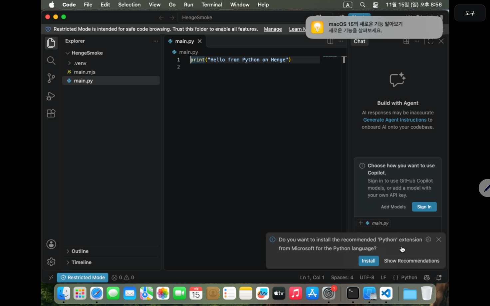
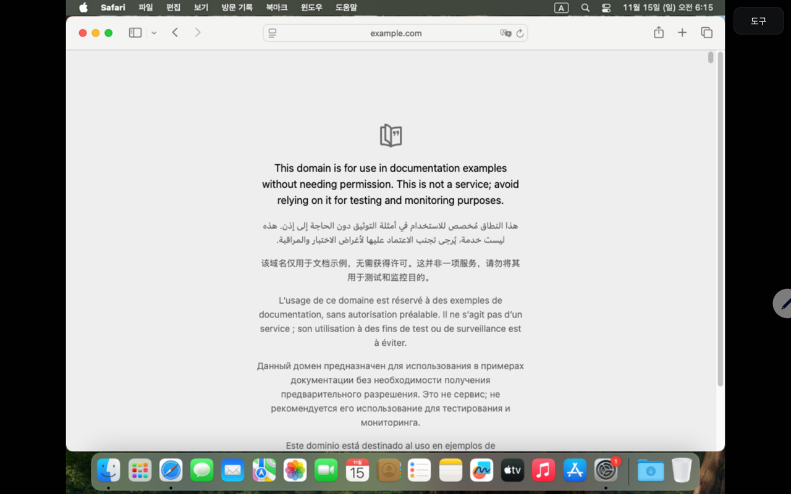
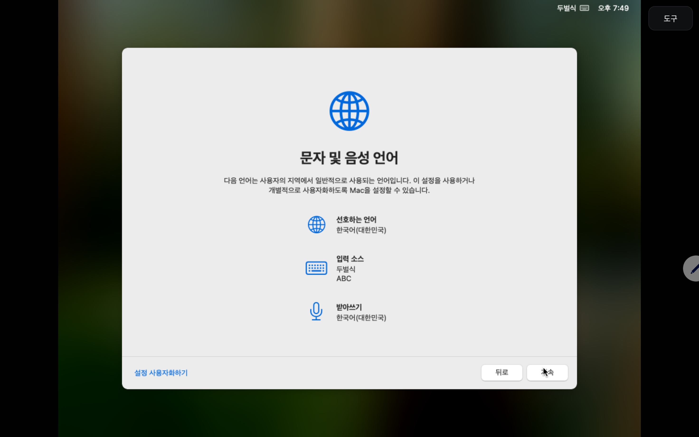

# NaruVM

[Korean guide](README.ko.md) · [Video](#video) · [Screenshots](#screenshots) · [Install](docs/installation.md) · [Compatibility](#status-and-devices) · [FAQ](#faq)

[](https://github.com/hericobacter-spec/NaruVM/actions/workflows/android-source.yml)

**[Download v0.1.3-preview APK](https://github.com/hericobacter-spec/NaruVM/releases/tag/v0.1.3-preview)** · **[APK install / source / checks](docs/apk-release.md)** · [Troubleshooting](docs/installation.md#troubleshooting)

An independent, experimental Android port of [Henge](https://github.com/Leviidev/Henge).
It retains Henge's ARM64-to-ARM64 JIT, software MMU and virtual devices, with
Android NDK/Bionic host adapters and an experimental Reims → metal2vulkan →
Vulkan graphics path. It is not an official Android release from upstream Henge.

**Experimental preview.** GPU faults, tablet reboots and slow interaction remain
unresolved. No near-native performance or everyday stability claim is made.
The v0.1.3-preview release provides a signed ARM64 APK, project/dependency source
archives, notices and checksums. Apple images, guest disks, accounts and private
signing keys are excluded. The exact candidate was tested on an emulator; its
physical-tablet and guest retest was unavailable.

**v0.1.2-preview graphics repair:** the observed emulator shader crash is fixed,
and unsupported system Vulkan now refuses cleanly. Five Auto checks and 150
authored readback frames passed. A small warm-cache probe improved from 143.7ms
to 70.0ms median; this is not a macOS speed measurement.
[Causes, reproduction and limits](docs/graphics-verification.md).

**v0.1.3-preview input/display update:** bounded input and worker-side frame preparation are now included in the signed APK (version code 4). Same-signer upgrade, authored frame/input and service tests passed on one emulator (observed). [Checks, reproduction and limits](docs/response-verification.md).

## Video

**[Watch / download the 20-second MP4](https://raw.githubusercontent.com/hericobacter-spec/NaruVM/main/docs/videos/historical-captures.mp4)** · [Video transcript and provenance](docs/videos/README.md)

[](https://raw.githubusercontent.com/hericobacter-spec/NaruVM/main/docs/videos/historical-captures.mp4)

A silent walkthrough assembled from the three historical screenshots below,
**not a live screen recording**. No execution-recording original was found in
the reviewed local research folders. The video does not demonstrate interaction
speed, a continuous install or sustained stability. Click the preview to open
the MP4; if your browser downloads it, open the saved file in a video player.

## Screenshots

Existing captures from the **single TB373FU macOS 15 research device**, before
v0.1. These are guest screens, not the current Android home. They demonstrate
individual observed screens, not complete automatic installation, sustained
stability or native-like speed. The guest UI in these captures is Korean.

| VS Code open in the guest | Safari displaying example.com |
| --- | --- |
|  |  |

<details>
<summary>Setup Assistant and capture context</summary>



The setup capture predates the new one-action Android installer. Existing
captures were copied without editing; no new guest session was run for this
update. [Capture provenance and limitations](docs/images/README.md).

</details>

## What NaruVM runs

NaruVM runs the guest locally on Android. It adapts Henge's same-ISA ARM64
translation and software MMU to Android; it does not use an Android hardware
hypervisor or require a remote Mac. Guest Metal commands go through Reims and
metal2vulkan to the selected Vulkan backend. CPU translation, memory handling
and GPU compatibility can each affect speed; matching the guest/host ISA does
not establish near-native performance.

The Android work adds a native English/Korean app, foreground VM/install
services, touch and external-input handlers, CPU/RAM/backend controls,
NAT/network adapters, and experimental Apple download/restore orchestration.
Upstream copyrights and dependency licenses remain in place. Internal
`henge` paths and the `dev.henge.research` package ID are retained; the app's
independent display name is NaruVM.

## Choose a starting point

Download the **[experimental APK](https://github.com/hericobacter-spec/NaruVM/releases/tag/v0.1.3-preview)** and follow [verification and installation](docs/apk-release.md).
The original [v0.1](https://github.com/hericobacter-spec/NaruVM/releases/tag/v0.1)
remains source-only. Existing research installs have a different signing key;
**preserve their guest data and use a separate device/emulator** for this preview.

For a first attempt: **install the APK → choose CPU/RAM/backend and run preflight
→ explicitly download/install a new guest → finish macOS setup**.
Start with 2 vCPU / 2048 MiB. The APK bundles graphics, CPU rendering and the
experimental PanVK path; Turnip is not bundled. The complete new automatic
installer remains unverified. [Build from source](docs/installation.md) if preferred.

| You want to… | Start here |
| --- | --- |
| Install without building | [APK, checksums and signer](docs/apk-release.md) |
| Understand requirements and build profiles | [Step-by-step installation](docs/installation.md) |
| Check source without an Android device | [Host checks below](#start-with-host-checks) |
| Modify/re-sign a native component | [Recipient modification guide](docs/apk-release.md#replace-an-lgpl-component-and-reinstall) |
| Recover from a build/install/boot problem | [Troubleshooting and logs](docs/installation.md#troubleshooting) |

The installation guide covers clone/toolchain setup, exact build commands,
USB debugging and signed updates, disk-free preflight, first setup, input,
networking and storage. The [build reference](docs/building.md) retains developer
verification and driver/source-reproduction details.

## Status and devices

Observed on 2026-11-16: one physical Lenovo TB373FU, Android 16, 4K host pages.
Desktop and local development-tool execution were observed in bounded research
runs. The latest portability smoke test reached the local login screen, accepted
input and stopped normally. These observations do not establish sustained use.

| Target | Current evidence |
| --- | --- |
| TB373FU / Dimensity 8300 / Mali | Bounded actual guest runs and disk-free pixel checks |
| Y700/Legion Tab, Snapdragon Galaxy tablets/phones | Capability/selection code and specification research; actual execution untested |
| Other ARM64 Android devices | Experimental capability-gated path; no all-device support claim |
| 16K host pages | Build alignment/policy checks only; runtime untested |

The [device matrix](android/device-support.json) names exact models and primary
specification sources. Regional/generation names are not a support allowlist.
Older CPUs may lack required instructions; this port does not emulate those
missing features. The 32-bit Android ABI has no build path.

## Start with host checks

From the source root, with Python 3.12+, a C compiler and JDK 21:

```sh
python3 tools/check_android_portability.py
python3 tools/check_publication.py
```

Expected markers: `PORTABILITY_HOST_RESULT failures=0` and
`PUBLICATION_SOURCE_RESULT failures=0`. These checks use no Android device,
guest image or network. They test CPU/backend/resource policy, driver packaging
boundaries and the source/notice/link inventory, not macOS execution.

An exported checkout records exact file hashes. After intentional source edits,
refresh and review that manifest before rerunning the publication check:

```sh
python3 tools/export_android_source.py --refresh-manifest
```

## Build and experiment

Follow the [installation guide](docs/installation.md) in order. It distinguishes
the diagnostic APK from the graphics configurations; all write the same local
APK filename, so the last successful build controls its contents.

The complete build helpers currently target an **Apple Silicon Mac**. A minimal
diagnostic APK and the optional graphics build are separate configurations.
See [build prerequisites and commands](docs/building.md), including optional
PanVK bootstrap steps. A basic APK does not include the macOS graphics runner.
The graphics build includes an experimental download → fresh install → first-boot
action; the complete automatic installation still needs real-device verification.

The conservative starting allocation is **2 vCPU / 2048 MiB guest RAM / 384 MiB JIT**.
The CPU control offers 1–4 vCPU; RAM offers 2048/3072/4096 MiB. The 384 MiB JIT cache
is a runtime default, not a home-screen allocation control.
The app lets users choose CPU, RAM and graphics for the next launch. Leave host
memory headroom, especially on phones. Normal guest sessions stop manually with
**Stop Mac**; they have no automatic duration limit or restart. Disk-free
diagnostics have separate limits.

With a graphics build, run **Check device compatibility** before opening
a guest. It checks host CPU/JIT conditions and an authored shared-memory 4096-pixel
result. A pass is a prerequisite, not macOS or driver-stability certification.

Automatic graphics selection preserves the observed PanVK path on TB373FU. A graphics+software-only build on TB373FU must explicitly select CPU rendering
or add the PanVK build; this model's Auto does not fall back. Other
models try an explicitly bundled Turnip, system Vulkan, then CPU rendering, using
the actual preflight result. Explicit selections fail without substitution, and
there is no fallback after a guest starts. A Turnip driver is not bundled by
default. CPU rendering is very slow. GPU model/Vulkan version alone does not
prove the exact shared-memory support this renderer needs.

## macOS versions and automatic installation

The graphics build has a version selector and **Download, install & start**.
This is a wired experimental flow, not a verified new-user installation claim.
Downloads are direct from Apple, checked against pinned length and SHA-256,
and kept in app-private storage. Incomplete downloads resume on retry; an
interrupted restore is preserved separately and retry creates another fresh disk.
The existing Mac stays selected until a new restore succeeds. Account setup
is completed inside macOS after first boot. English and Korean UI are included.

| Version / build | Apple download | Android evidence |
| --- | --- | --- |
| 15.6.1 / 24G90 | 15.66 GiB | Prior tablet desktop observed; new complete automatic install untested |
| 26.6.2 / 25G83 | 18.41 GiB | Experimental selection/download/install path; installation and boot untested |
| 27.2 / 26B123 | 23.84 GiB | Experimental selection/download/install path; installation and boot untested |

Catalog metadata was observed from Apple CDN on 2026-11-16. A selectable version
or available file does not establish Android compatibility. The app estimates
storage headroom before starting; larger images/restore writes can require more.
Keep the app open during installation. If Android pauses a background download,
return and retry. There is no automatic VM duration deadline. With an empty download cache, current source estimates are about 49.7/60.4/73.8 GiB
free internal app storage for the three versions respectively, not total device
capacity. Use the app's current estimate and allow for retained incomplete disks. Read
[installation details](docs/installation.md#7-download-and-install-a-fresh-macos-guest) and
[Apple license constraints](docs/licensing.md) before use.

## Daily controls and networking

Launch contains the selected Mac and resource settings. Diagnostics/Tests contains
disk-free probes; Logs contains session export and packaged license/source notices.
After installation, finish language/region/local-account setup inside macOS. The
guest sees a virtual wired NIC with Android-side NAT/DNS; it does not browse the
host Wi-Fi radio. An empty Wi-Fi list is therefore not sufficient to diagnose an
Internet failure. See [first boot and use](docs/installation.md#8-first-boot-and-normal-use)
for input-source switching, normal stop and reporting a failure.

## External mouse and keyboard

The Mac display forwards Android-recognized USB/Bluetooth keyboard and mouse
input while focused. Click the display first. Movement, left/right/middle buttons,
dragging and horizontal/vertical wheels have handlers. Hardware movement no longer
divides travel by display zoom; a 0.5×–3× speed selector defaults to 1×. The tools button
**Lock external mouse · Esc to release** enables relative pointer capture; Escape releases it.
Meta/Windows maps to Command, Alt to Option and Ctrl to Control. macOS chooses
the input source; Android-reserved system shortcuts may be intercepted.

Observed: authored host checks and Android framework event-dispatch tests on
TB373FU pass. **Physical USB/Bluetooth-to-macOS interaction remains untested.**
This forwards input events, not arbitrary USB devices. See
[input verification](docs/building.md#external-input-verification).

## FAQ

**Can I download an APK instead of building?** Yes: the experimental
[v0.1.3-preview](https://github.com/hericobacter-spec/NaruVM/releases/tag/v0.1.3-preview).
Follow the [signer, checksum and installation guide](docs/apk-release.md).
The original v0.1 is preserved as source-only.

**Does it need a remote Mac or root on Android?** Guest execution is local.
The documented build host is an Apple Silicon Mac; Android runs the app through
its ordinary app/JIT/driver paths. Passing the app's CPU/GPU checks is still
required. This is not an Android hardware hypervisor.

**Will my Y700 or Snapdragon Galaxy work?** The source includes portable
selection paths, but those devices have not been tested. Report the exact
model/SoC, Android version, page size and backend; a product family or Vulkan
version is not enough. Use the [device report](https://github.com/hericobacter-spec/NaruVM/issues/new?template=device_report.yml).

**Why is Wi-Fi missing in macOS?** The guest gets a virtual Ethernet adapter
through Android NAT/DNS. It does not control the tablet's Wi-Fi radio. See the
[network troubleshooting table](docs/installation.md#troubleshooting).

**Are macOS 26/27 or the screenshots proof of the new installer?** No. The
screenshots show earlier macOS 15 research runs. The new full automatic install
and 26/27 installation/boot remain unverified.

**What should I do about crashes or poor speed?** Treat this as an experiment.
GPU faults, tablet reboots and slow interaction remain unresolved. Keep the
selected backend/build profile in your report, stop normally when possible,
and attach a sanitized [session log](docs/installation.md#collect-a-useful-report).
Increasing CPU/RAM is not a demonstrated universal fix.

## Help improve NaruVM

Useful contributions include measured CPU/JIT performance work, reproducible
GPU/lifecycle failures, exact-model device reports and closure of the
[APK source/build requirements](docs/binary-release.md). Start with
[CONTRIBUTING](CONTRIBUTING.md) and an isolated reproducible case. Report bugs
through the [bug form](https://github.com/hericobacter-spec/NaruVM/issues/new?template=bug_report.yml).
Never attach guest disks, credentials, private captures or signing keys.

## Related projects

- [Henge](https://github.com/Leviidev/Henge): the upstream CPU/MMU/device foundation.
- [UTM](https://github.com/utmapp/UTM): QEMU-based system emulation and virtualization on Apple platforms.
- [Winlator](https://github.com/brunodev85/winlator): Wine/Box-based Windows application execution on Android.
- [Termux](https://github.com/termux/termux-app): Android terminal and Linux environment.

Their runtime architectures and supported guests differ. UTM's screenshot and
install/developer separation, Winlator's concise install/tips and Termux's
installation/debugging structure informed this documentation; their download
availability or popularity is not evidence of NaruVM compatibility.

## Licenses and attribution

Henge and original Android-port changes retain **GPL-2.0-or-later**. Third-party
and per-file terms remain in effect. Read [NOTICE](NOTICE), the
[license review](docs/licensing.md) and [component inventory](android/publication/licenses.json).
The combined research APK selects the GPLv3 option while retaining upstream
grants. Version-matched Termux recipes and checksum-pinned source inputs are
recorded. Download both project and dependency source archives with the APK;
the project-only archive is not the complete source set. Historical producer
attestation and independent external rebuilds remain unclaimed. See the
[artifact-specific review](docs/apk-release.md#source-provision-versus-rebuild-attestations).

The project license grants no rights to Apple software. The
[macOS Sequoia license](https://www.apple.com/legal/sla/docs/macOSSequoia.pdf)
includes Apple-branded-system restrictions. Owning a device does not itself
establish a macOS license for Android. No Apple software or private guest files
belong in a source contribution or release.

## Contribute and prepare a release

[Contributing](CONTRIBUTING.md) · [Security/reporting](SECURITY.md) ·
[Architecture](docs/architecture.md) · [Changelog](CHANGELOG.md) ·
[Publication procedure](docs/publication.md)

The GitHub workflow performs read-only host/source checks. It does not build or
publish an APK, access a device or certify legal compliance. The local
publication tool creates a separate Git staging tree with no commit or remote;
it does not upload anything. Review that tree before any public action.

The [final source gate](docs/publication.md#3-run-the-final-offline-source-gate)
checks actual staged Git bytes, host policies, negative boundary tests and
deterministic source archives. It is also the workflow's check command. A local
source-gate pass covers source publication preparation. Separate artifact-level
checks and remaining limits are recorded in the [APK guide](docs/apk-release.md).

See the [current APK source correspondence audit](docs/source-correspondence.md)
for per-file origins, exact payload/rebuild checks and remaining source gates.
